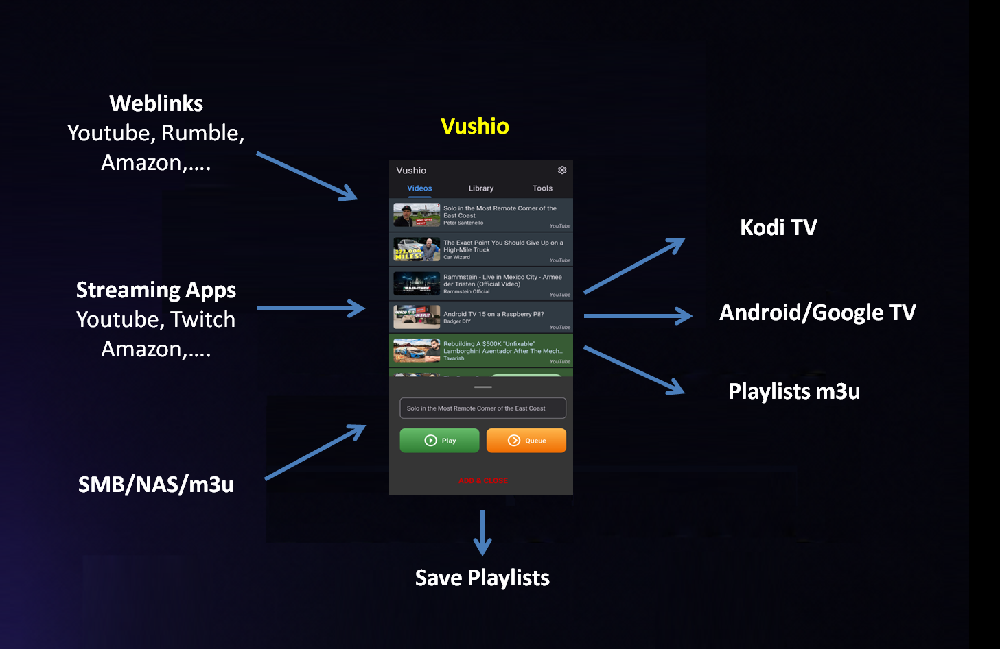

# Fire2kodi

## Further development at [Codeberg](https://codeberg.org/Isayso) Also on F-Droid IzzyOnDroid Repo 

Android app to send video links to Kodi TV device via clipboard or send-to menu. 
Kore sends links to Kodi devices but cannot translate them for the specific video Addons. 
This app translates links from web for various video Addons.  

## Supported Kodi Addons:
### Youtube, Rumble, Odysee, Bitchute, Amazon Prime, Joyn, Twitch, Kick 

For US and UK citizens you can get the full version of [Vushio](https://sites.google.com/view/vushioapp/startseite) which also sends video links to Android/Google TVs on Google Play Store:   
[Google Play Store](https://play.google.com/store/apps/details?id=com.vushio.app)

## Supported Android TV Apps (Vushio Full version):
### Youtube, VLC, Amazon Prime, Joyn, Twitch, Kick

  
  

