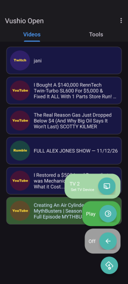

# Fire2kodi

## Further development at [Codeberg](https://codeberg.org/Isayso) Also on F-Droid IzzyOnDroid Repo 

Android app to send video links to Kodi TV device via clipboard or send-to menu. 
Kore sends links to Kodi devices but cannot translate them for the specific video Addons. 
This app translates links from web for various video Addons.  

## Supported Kodi Addons:
### Youtube, Rumble, Odysee, Bitchute, Amazon Prime, Joyn, Twitch, Kick 

## Supported Android TV Apps (Vushio full version on Google Play Store):
### Youtube, VLC, Amazon Prime, Joyn, Twitch, Kick

